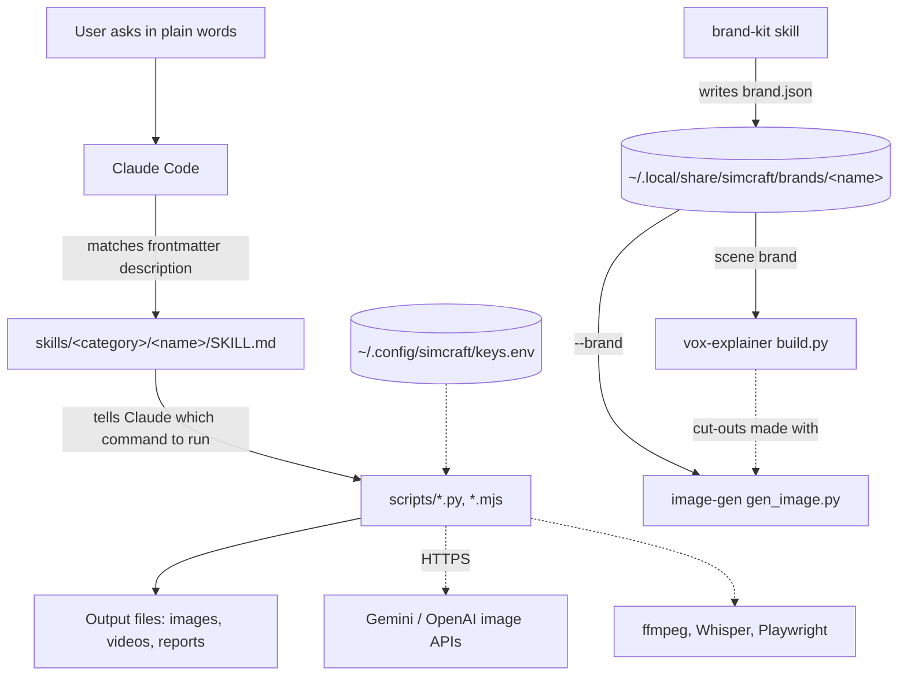

# simcraft: codebase map

Snapshot of this repo on 2026-11-07, while the newer skills were being added. Made with the codebase-map skill, as a worked example. Author names are left out.

## What it is

simcraft is a collection of Claude Code skills. Each skill is a folder with a `SKILL.md` (instructions plus a `description` that tells Claude when to use it) and, for most, a `scripts/` folder of small command-line tools. A person asks Claude for something in plain words ("make an image of...", "trim the fat from this video"), Claude picks the skill whose description matches, reads its `SKILL.md`, and runs the scripts it names. The outputs are files on the user's machine: images, videos, reports. Some scripts call outside services (Gemini and OpenAI image APIs, Whisper models run locally, ffmpeg, a headless browser through Playwright). There is no server, database or build step.

## How to run it

- Install: link every skill folder into `~/.claude/skills`, one level deep (README.md:80). Claude Code does not look inside the category folders (`skills/video/...`), which is why the links are needed. (read)
- Python scripts are standard library only, except the ones with a `setup.sh` next to them (rough-cut, reverse-engineer-video, paper-to-runnable), which build a `.venv` inside the skill folder with Whisper or numpy. (read)
- Node scripts need `playwright` from the root `package.json`. (read)
- API keys come from the environment or `~/.config/simcraft/keys.env` (skills/design/image-gen/scripts/gen_image.py:22), never from the command line. (read)
- There is no CI and no test runner at the root. A few skills ship their own self-tests in `examples/`. (read, from `entrypoints.py`: "CI pipelines: none found")

## Architecture

The import graph has no edges between skills: every skill is self-contained, and `deps.py` puts all 18 folder boxes on level 0. The real architecture is a convention plus a few shared files on disk:

The two dotted stores on the left and right are outside the repo on purpose: keys must never be committed, and brand kits hold other companies' fonts and logos (skills/design/brand-kit/SKILL.md:10). They are the only shared state between skills.

## One request, end to end

Traced: "make a transparent cut-out of a red teapot", which runs
`python3 skills/design/image-gen/scripts/gen_image.py "a red teapot" --cutout --out <tmp> --name teapot`.
It was run for real under `scripts/trace_py.py`, with the network stubbed at `urllib.request.urlopen` (a canned model list and a tiny green PNG), so no key or money was used. It wrote `teapot.png` and `teapot.json`. (ran)

1. skills/design/image-gen/scripts/gen_image.py:227 The script is one top-level program, not a module with a `main()`. Argument parsing is hand-rolled with `sys.argv` and `opt()`.
2. skills/design/image-gen/scripts/gen_image.py:27 `key()` looks for the key in the environment, then aliases, then the keys file. It is called several times per run and rereads the file each time.
3. skills/design/image-gen/scripts/gen_image.py:62 `gemini_pick()` picks the newest "pro" image model. With no `--model`, this costs one extra API call per run (`gemini_models()` at :56, which uses `get()` at :51).
4. skills/design/image-gen/scripts/gen_image.py:252 If `--brand` is given, the brand kit's image style is appended to the prompt.
5. skills/design/image-gen/scripts/gen_image.py:276 Images are made in a thread pool, one `one()` call (:265) per variation.
6. skills/design/image-gen/scripts/gen_image.py:72 `gemini()` builds the request; `post()` at :39 sends it and retries 429 and 5xx errors with a growing wait.
7. skills/design/image-gen/scripts/gen_image.py:158 For Gemini cut-outs, `chroma_cut()` removes the green background using its own PNG reader and writer (:123, :151), so Pillow is not needed.
8. skills/design/image-gen/scripts/gen_image.py:280 A sidecar JSON with the exact prompt and settings is written next to the image, so any image can be made again.

Surprise on the path: the prompt sent to the API is not the prompt the user typed. Brand style and the chroma-key instructions are added to it, and only the sidecar's `sent_prompt` field shows the final text.

## Data model

There is no database. The data that matters is on disk:

| Data | Shape | Written by | Read by |
|---|---|---|---|
| Brand kit | `brand.json` plus font and logo files in `~/.local/share/simcraft/brands/<name>/` | brand-kit `propose.py` | image-gen `--brand` (skills/design/image-gen/scripts/gen_image.py:252), vox-explainer scene `brand` (skills/video/vox-explainer/scripts/build.py:88) |
| Image sidecar | `<name>.json` with prompt, sent prompt, model, settings | skills/design/image-gen/scripts/gen_image.py:280 | People, to remake an image |
| Vox scene | `scene.json` with beats timed to the voiceover | Claude, following the vox-explainer SKILL.md | vox-explainer `build.py` |
| Keys | `NAME=value` lines in `~/.config/simcraft/keys.env` | The user, by hand | skills/design/image-gen/scripts/gen_image.py:27 |

## Where the important code lives

Git history is short (15 commits, one author), so these are hints, not strong signals.

| File | Why it matters |
|---|---|
| skills/design/image-gen/scripts/gen_image.py | Top hotspot (changes x complexity). Used directly and by vox-explainer and brand-kit workflows |
| skills/video/rough-cut/scripts/find_cuts.py | Second hotspot. The cut decisions for talking-head edits |
| skills/video/clean-audio/scripts/clean_audio.py | Third hotspot. The audio cleanup chain |
| skills/video/rough-cut/scripts/common.py | Most imported file in its skill (find_cuts, transcribe, render, verify all import it) |
| skills/video/vox-explainer/scripts/build.py | Turns a scene file into frames and video; reads brand kits |

Probably dead: none found. `deps.py` lists no orphans, but it treats every file in a `scripts/` folder as an entry point, so that only means no library file is unused. Each script is named in its skill's `SKILL.md` or imported by a script that is.

## Hidden coupling

From `hotspots.py --days 0 --min-shared 2 --deps`, pairs that changed together with no import between them:

- skills/design/image-gen/scripts/gen_image.py, skills/video/vox-explainer/scripts/build.py and skills/design/brand-kit/scripts/board.py changed together in 2 to 3 commits. They share the brand kit format by convention only. A change to `brand.json` fields must be checked in all three.
- skills/video/rough-cut/scripts/common.py and skills/video/clean-audio/scripts/common.py are byte-for-byte copies. clean-audio imports its own copy (skills/video/clean-audio/scripts/clean_audio.py:15). A fix in one does not reach the other.

## Who knows what

One author wrote everything, so there is no knowledge-at-risk list. For a solo repo, the risk is the reverse: undocumented decisions live in one head. The `SKILL.md` files are where those decisions are written down, so read them before changing a script.

## Glossary

| Term | Meaning here | Where |
|---|---|---|
| Skill | A folder with a `SKILL.md`; the unit Claude loads | README.md |
| Frontmatter description | The `description:` line at the top of `SKILL.md`. Claude uses it alone to decide whether the skill fits a request, so its trigger phrases matter | skills/coding/codebase-map/SKILL.md:3 |
| Category folder | `skills/video`, `skills/design` and so on. For browsing only; Claude never sees them | README.md:80 |
| Brand kit | A saved brand (colours, fonts, logo, image style) that image-gen and vox-explainer apply | skills/design/brand-kit/SKILL.md:10 |
| Cut-out | A transparent PNG of one object, for collage layouts | skills/design/image-gen/scripts/gen_image.py:158 |
| Sidecar | The `.json` written next to each generated image | skills/design/image-gen/scripts/gen_image.py:280 |
| Scene | The JSON file that drives a vox-explainer video | skills/video/vox-explainer/scripts/build.py:88 |
| Style C | The chosen visual style for vox-explainer videos | skills/video/vox-explainer/SKILL.md |

## Gotchas

- Adding a skill folder is not enough: it must be linked into `~/.claude/skills` (README.md:80), or Claude never sees it.
- `common.py` is copied, not shared, between rough-cut and clean-audio. Fix both.
- `gen_image.py` runs on import (top-level code), so it cannot be imported for a unit test. Test it by running it, with the network stubbed as in the trace above.
- Shared state lives outside the repo (`~/.config/simcraft`, `~/.local/share/simcraft`). A fresh clone has none of it, and brand-dependent commands fail with "Run the brand-kit skill first".
- Skills with `setup.sh` keep a `.venv` inside the skill folder. It is ignored by git, so every new machine needs the setup step.
- The working tree often holds several new skills that are not committed yet, so git history describes only part of what is on disk.

## First tasks to try

1. Run `gen_image.py --check` to see which keys it finds, then trace one run with the network stubbed, as above. This teaches the request path of the most changed script.
2. Make clean-audio import rough-cut's `common.py`, or extract one shared copy, and run both skills once to confirm nothing broke.
3. Add `--model` to the image-gen examples in its `SKILL.md`, or cache the chosen model, to save one API call per run.
4. Write a fresh-clone install check: clone into a temp folder, run the README loop, and confirm every skill folder has a `SKILL.md` with `name` and `description`.
