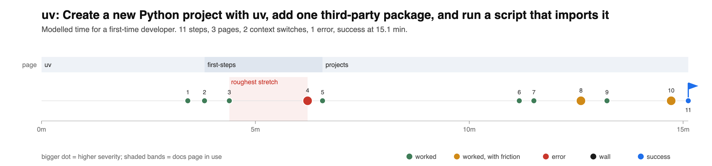

# uv: developer experience audit

**Goal:** Create a new Python project with uv, add one third-party package, and run a script that imports it  
**Success means:** In a brand-new project, uv run example.py imports a package added with uv add, prints its output, and exits 0  
**Docs:** https://docs.astral.sh/uv/  
**Environment:** macOS 15 (arm64), zsh, empty HOME and PATH=/usr/bin:/bin (no uv, no Homebrew), system Python 3.9.6  
**Date:** 2026-11-07

## Summary

A new developer on a clean Mac gets from the uv docs home page to a working project with a third-party package in about 15 minutes, most of it reading, with one small stumble and no signup. The path is short and the docs match what the tool really does, down to the folder tree that `uv init` prints. The weak spot is not the happy path but the first mistake: two of three common errors were graded D, mostly because the hints point at the wrong cause (a typo gets a hint about Python versions). The one change that would help most is to make the "package not found" error say "check the spelling" and drop the unrelated hints.

| Metric | Result |
|---|---|
| Reached the goal | Yes |
| Time to first success (modelled, first-time developer) | 15.1 min |
| Time to first success (agent wall clock) | 3.3 min |
| Steps to success | 11 (7 commands) |
| Docs pages visited / context switches | 3 / 2 |
| Had to leave the docs for | nothing |
| Errors before success | 1 |
| Signup or key walls | 0 |
| Lines of code written | 3 |
| Friction points (sev 1 / 2 / 3) | 3 (3 / 0 / 0) |
| Error message quality | 3.7/6 average |
| Roughest stretch | steps 4 to 4 (missing-step) |



## The journey

| # | Min | Page | What I did | Result | Friction |
|---|---|---|---|---|---|
| 1 | 3.4 | [uv](https://docs.astral.sh/uv/) | Land on the docs home and find the install command | ok |  |
| 2 | 3.8 | [uv](https://docs.astral.sh/uv/) | Run the standalone installer: `curl -LsSf https://astral.sh/uv/install.sh \| sh` | ok |  |
| 3 | 4.4 | [first-steps](https://docs.astral.sh/uv/getting-started/first-steps/) | Follow 'first steps' link to check the install | ok |  |
| 4 | 6.2 | [first-steps](https://docs.astral.sh/uv/getting-started/first-steps/) | Run uv in the same terminal, as first steps says: `uv` | fail | missing-step (sev 1) |
| 5 | 6.6 | [first-steps](https://docs.astral.sh/uv/getting-started/first-steps/) | Source the env file the installer printed, then run uv: `source $HOME/.local/bin/env && uv` | ok |  |
| 6 | 11.2 | [projects](https://docs.astral.sh/uv/guides/projects/) | Open the 'Working on projects' guide from first steps | ok |  |
| 7 | 11.5 | [projects](https://docs.astral.sh/uv/guides/projects/) | Create a project: `uv init hello-world` | ok |  |
| 8 | 12.6 | [projects](https://docs.astral.sh/uv/guides/projects/) | Try the generated entry point: `cd hello-world && uv run hello-world` | ok | version-mismatch (sev 1) |
| 9 | 13.2 | [projects](https://docs.astral.sh/uv/guides/projects/) | Add a dependency (Running commands section): `uv add flask` | ok |  |
| 10 | 14.7 | [projects](https://docs.astral.sh/uv/guides/projects/) | Save the docs script as example.py (copied with the copy button) | ok | naming-confusion (sev 1) |
| 11 | 15.1 | [projects](https://docs.astral.sh/uv/guides/projects/) | Run the script in the project: `uv run example.py` | success |  |

**Install (steps 1 to 5).** The docs home puts the install command first, with a copy button that copies the command without the `$` prompt ([screenshot](screenshots/01-docs-home.png)). The installer took 3.4 seconds and needed no account. It ended with:

```
To add $HOME/.local/bin to your PATH, either restart your shell or run:
    source $HOME/.local/bin/env (sh, bash, zsh)
```

The docs then send the reader to [First steps](screenshots/02-first-steps.png), which says to run `uv` to check the install. In the same terminal that gives `zsh:1: command not found: uv`. The fix is in the installer output a few lines up, so most people recover quickly, but the docs page never mentions it, and people who skim install output (most of us) hit it.

**Project (steps 6 to 8).** The [Working on projects](screenshots/03-guide-projects.png) guide is clear. `uv init hello-world` made exactly the files the guide lists, and `uv run hello-world` printed `Hello from hello-world!` with no virtual environment to create or activate by hand. One thing was quietly different: uv chose the macOS system Python 3.9.6 (`Using CPython 3.9.6 interpreter at: /Library/Developer/CommandLineTools/usr/bin/python3`) and wrote `requires-python = ">=3.9"`, where the guide shows `>=3.14`. Python 3.9 reached end of life in October 2025, and nothing said so. This matters later: it is the root cause of the version error in the error checks below.

**Dependency and script (steps 9 to 11).** `uv add flask` resolved and installed 10 packages in 16 seconds on a cold cache. The guide's script example has no file name, so the reader has to guess `example.py` from the command under it. With that, `uv run example.py` printed `hello world` and exited 0.

## Friction found

- **#4 missing-step, severity 1 (annoying).** First steps says to run uv right after installing, but in the same terminal uv is not on PATH yet. The installer output does say to restart the shell or source $HOME/.local/bin/env, so a careful reader recovers in seconds; the docs page itself never mentions it. Fix: Add one line under the uv example on First steps: 'If you see command not found, open a new terminal or run source $HOME/.local/bin/env (the installer printed this).'
- **#8 version-mismatch, severity 1 (annoying).** uv init quietly picked the system Python 3.9.6 (end of life since October 2025) and wrote requires-python >=3.9 and .python-version 3.9. The guide shows requires-python >=3.14. Nothing told me which Python I got or that it is unsupported upstream. Fix: When uv init falls back to an end-of-life interpreter, print one line: 'Using system Python 3.9.6, which is end of life. Run uv python install 3.14 and uv python pin 3.14 for a supported version.' In the guide, add a sentence that the version shown depends on the Pythons already on the machine.
- **#10 naming-confusion, severity 1 (annoying).** The script block has no file name; the reader has to infer example.py from the next command. Fix: Put a title on the block (example.py), which Material for MkDocs supports with title="example.py".

## Error messages

Each mistake was made on purpose. Grades: does the message say what happened, why, and how to fix it (0 to 2 each).

| Mistake | What | Why | Fix | Grade |
|---|---|---|---|---|
| Wrong version: a package version that needs a newer Python | 2 | 2 | 1 | B (5/6) |
| Typo in the package name | 2 | 1 | 0 | D (3/6) |
| Typo in the script file name | 2 | 1 | 0 | D (3/6) |

### Wrong version: a package version that needs a newer Python

```
$ uv add "numpy>=2.1"
error: Failed to add dependencies
  cause: No solution found when resolving dependencies for split (markers: python_full_version == '3.9.*')
  cause: Because the requested Python version (>=3.9) does not satisfy Python>=3.11 and all of:
             numpy>=2.3.0,<=2.4.0rc1
... (40 lines cut) ...
             numpy>2.4.0
          cannot be used.
         And because numpy==2.4.0 was yanked (reason: Backward compatibility bug) and your project depends on numpy>=2.1, we can conclude that your project's requirements are unsatisfiable.

hint: The `requires-python` value (>=3.9) includes Python versions that are not supported by your dependencies (e.g., all of:
    numpy>=2.3.0,<=2.4.0rc1
    numpy>=2.4.1,<=2.4.6
 only support >=3.11). Consider using a more restrictive `requires-python` value (like >=3.11).

hint: If you want to add the package regardless of the failed resolution, provide the `--frozen` flag to skip locking and syncing
```

Correct and complete, but the answer is the last 6 of about 50 lines; a newcomer sees a wall of version ranges first. The hint says to raise requires-python to >=3.11. Doing only that gives a second error, because .python-version still says 3.9. That second error is good (it names uv python pin), so recovery takes two rounds instead of one. The --frozen hint invites skipping the lock, which is the wrong move for a newcomer.

A clearer message:

```
error: numpy>=2.1 needs Python 3.10 or newer, but this project allows Python 3.9 (requires-python = ">=3.9", .python-version = 3.9).
fix:   uv python pin 3.11 && set requires-python = ">=3.11" in pyproject.toml, then run uv add "numpy>=2.1" again
       (or pick an older version: uv add "numpy<2.1")
run with --verbose to see the full resolution.
```


### Typo in the package name

```
$ uv add flask-sqlalchemyy-xyz
error: Failed to add dependencies
  cause: No solution found when resolving dependencies for split (markers: python_full_version >= '3.11')
  cause: Because flask-sqlalchemyy-xyz was not found in the package registry and your project depends on flask-sqlalchemyy-xyz, we can conclude that your project's requirements are unsatisfiable.

hint: While the active Python version is 3.9, the resolution failed for other Python versions supported by your project. Consider limiting your project's supported Python versions using `requires-python`.

hint: If you want to add the package regardless of the failed resolution, provide the `--frozen` flag to skip locking and syncing
```

The key line is clear: the package was not found in the registry. But the first hint blames the project's Python versions, which has nothing to do with a typo, and the second suggests --frozen, which would write a package that does not exist into pyproject.toml. No 'did you mean' and no link to search the index.

A clearer message:

```
error: no package named flask-sqlalchemyy-xyz on PyPI (https://pypi.org/simple).
hint:  check the spelling. Did you mean flask-sqlalchemy?
```


### Typo in the script file name

```
$ uv run exmaple.py
Building hello-world @ file://~/hello-world
      Built hello-world @ file://~/hello-world
Uninstalled 1 package in 1ms
Installed 1 package in 1ms
error: Failed to spawn: exmaple.py
  cause: No such file or directory (os error 2)
```

Says the file could not be found, so a careful reader gets there. 'Failed to spawn' is process jargon, and the message does not notice that example.py, one letter away, exists in the same folder. It also rebuilt and reinstalled the project before failing, which adds noise above the error.

A clearer message:

```
error: exmaple.py not found in the current directory.
hint:  did you mean example.py?
```

## Top 5 fixes

Ranked by impact (how many people it saves, and how much time) over effort (how much work for the team).

| # | Fix | Impact | Effort |
|---|---|---|---|
| 1 | "Package not found" error: say check the spelling, drop the unrelated hints | High | S |
| 2 | Version conflict error: one-line summary first, and a fix that works in one go | High | M |
| 3 | First steps: one line for "command not found" after install | Medium | S |
| 4 | `uv init`: say which Python was picked when it is end of life | Medium | S |
| 5 | `uv run` with a missing file: plain words and "did you mean" | Low | S |

### 1. Package not found

Now: the real cause (`flask-sqlalchemyy-xyz was not found in the package registry`) sits under a "No solution found ... for split" line, and is followed by a hint to narrow `requires-python` and a hint to use `--frozen`. Neither applies to a typo, and `--frozen` would write a package that does not exist into `pyproject.toml`.

Suggested message:

```
error: No package named `flask-sqlalchemyy-xyz` was found on PyPI.
hint: Check the spelling. Similar names: flask-sqlalchemy
```

When every failure in a resolution is "not found", skip the `requires-python` and `--frozen` hints.

### 2. Version conflict

Now: about 50 lines of reasoning before the hint, and the hint's fix (raise `requires-python`) leads to a second error, because `.python-version` still says 3.9. Following both errors works (checked: `uv python pin 3.11`, then `uv add "numpy>=2.1"` installed numpy 2.4.6), but it takes two rounds.

Suggested message, with the full proof behind `--verbose`:

```
error: numpy>=2.1 needs Python 3.10 or newer, but this project allows Python 3.9
       (requires-python = ">=3.9" in pyproject.toml, 3.9 in .python-version).
hint: To use a newer Python: uv python pin 3.11, set requires-python = ">=3.11", then run uv add again.
hint: To stay on Python 3.9: uv add "numpy<2.1"
```

### 3. First steps after install

Now: "After installing uv, you can check that uv is available by running the uv command."

Suggested text, added under the example:

```
If your shell says "command not found", open a new terminal, or run the line the
installer printed: source $HOME/.local/bin/env
```

### 4. End-of-life Python picked silently

Now: `Using CPython 3.9.6 interpreter at: /Library/Developer/CommandLineTools/usr/bin/python3`, then no further comment, and the project is pinned to 3.9.

Suggested extra line when the chosen interpreter is past end of life:

```
warning: Python 3.9 is end of life. For a supported version: uv python pin 3.14
```

In the guide, one sentence under the `pyproject.toml` example: "Your `requires-python` depends on the Python versions already installed, so it may differ from this example."

### 5. Missing script file

Now: `error: Failed to spawn: exmaple.py` / `cause: No such file or directory (os error 2)`, after rebuilding the project.

Suggested message:

```
error: File not found: exmaple.py
hint: Did you mean example.py?
```

Also small: give the script block in the projects guide a title, `title="example.py"`, so the reader does not have to guess the file name.

## What they do well

- **The install is one command with no account (step 2).** 3.4 seconds, no signup, no key, no card. The installer tells you exactly what to run next.
- **Copy buttons are right everywhere.** Every visible code block on the three pages (32 blocks) was copied with its button and checked. None copied the `$` prompt, and blocks that mix commands with sample output copy only the commands. This removes a whole class of copy-paste mistakes.
- **The docs match the tool (step 7).** `uv init` produced exactly the folder tree the guide shows. That kind of accuracy is rare and is why the path took only one recovery.
- **No environment juggling (steps 8 and 11).** `uv run` created the virtual environment, the lockfile and the install on its own. The reader never has to learn `activate` to reach the goal.
- **No dead links.** All links on the three pages were checked (196, 97 and 194 per page): none broken. One first looked broken (`crates.io` refuses scripted requests) but loaded fine in a real browser.
- **The second-round error is a model to copy.** `The Python request from .python-version resolved to Python 3.9.6, which is incompatible with the project's Python requirement: >=3.11` followed by `Use uv python pin to update the .python-version file` says what happened, why, and what to type. Fixes 1, 2 and 5 ask for every error to work like this one.

## Method

Fresh empty folder, no prior knowledge used beyond the official docs, docs followed literally in order. Modelled time charges each new docs page at 238 words a minute (at most 6 minutes a page), 20 s to copy and run each command plus its run time, 15 s per line of code, and 1 min, 1.5 min, 4 min, 10 min to work through a failure of severity 0, 1, 2 and 3. Raw log: `friction.json`. Command output: `outputs/`. Page captures: `snapshots/` and `screenshots/`.
