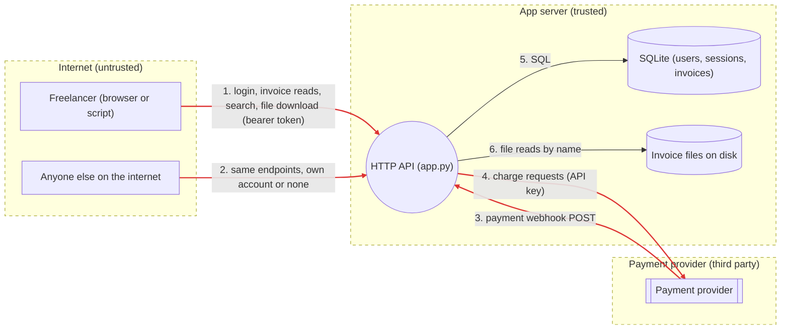

# Threat model: Tinybill invoice API

Worked example for the `security-threat-model` skill. `vulnerable/app.py` is the "before" code, `fixed/app.py` is the "after" code, and `tests/test_threats.py` holds the proofs, which are now regression tests.

Last reviewed: 2026-11-07, against `vulnerable/app.py` and `fixed/app.py` in this folder.

## Scope

- **In scope:** the HTTP API in `app.py` (six routes), its SQLite database, the invoice files on disk, the payment webhook, and the payment API key.
- **Out of scope:** the host, the reverse proxy and TLS (assumed to terminate HTTPS in front of the app), the payment provider's own systems, and any front end.
- **Assumptions:** the app is reachable from the internet. Anyone can create or steal one ordinary account, so "attacker" in this document means a logged-in user who is not the owner of the data, unless it says unauthenticated.
- **How it was tested:** every proof ran against a server on 127.0.0.1 with a throwaway data folder. Nothing was sent to a real payment provider or any other system.

## Data flow

Generated with `python3 ../../scripts/dataflow.py dataflow.yaml`. Red arrows cross a trust boundary.



## Assets

| Asset | Why it matters |
|---|---|
| Invoices of every customer | Client names and amounts are confidential business data. One customer seeing another's is a breach. |
| Session tokens | A token is a full login. Leaking one is account takeover with no password needed. |
| Password hashes | Offline cracking leads to account takeover here and on other sites where people reuse passwords. |
| Invoice status (paid or unpaid) | Money decisions depend on it. A fake "paid" means work delivered for free. |
| Payment API key | Lets whoever holds it charge or refund through our account. |
| Server files (database file, config, backups key) | Reading `app.db` gives every token and hash at once. |

## Trust boundaries

1. **Internet to API.** Everything in the request is attacker-controlled: path, query, body, headers. The API must authenticate the caller and then check that the caller owns each object it touches.
2. **Payment provider to API (webhook).** The webhook URL is public, so "comes from the provider" has to be proven with a signature, not assumed.
3. **API to payment provider.** Crossed with our API key. The key must not exist anywhere outside the server's environment.
4. **API to database and disk.** Inside the server, but every query and path is built from data that came across boundary 1.

## Threats

Rating is likelihood (1 to 3) times impact (1 to 3). Likelihood 3 means any logged-in user or anyone on the internet can do it with a single request. Impact 3 means other customers' data or money.

| ID | Element | STRIDE | Threat | L | I | Score | Status |
|---|---|---|---|---|---|---|---|
| T1 | `GET /api/invoices/{id}` | I, E | IDOR: any logged-in user reads any invoice by changing the id. Ids are sequential, so all of them can be listed in a loop. | 3 | 3 | 9 | Fixed, test |
| T2 | `GET /api/search` | I, T, E | SQL injection through `q`. Escapes the owner filter and, with `UNION`, reads the sessions table: every user's live token. | 3 | 3 | 9 | Fixed, test |
| T3 | `GET /api/files` | I | Path traversal through `name` (`../`, `../2/...`, or an absolute path). Reads other users' files, server secrets, and `app.db` itself. | 3 | 3 | 9 | Fixed, test |
| T4 | `POST /api/webhooks/payments` | S, T | Unauthenticated, unsigned webhook. Anyone can mark any invoice paid. A captured real event could also be replayed. | 3 | 2 | 6 | Fixed, test |
| T5 | Source code, repo history | I | Payment API key hardcoded in `app.py`, so it is in every clone, fork and backup, and in git history forever. | 2 | 3 | 6 | Fixed, test (key must also be rotated) |
| T6 | API error handler | I | Exception text returned to the client (`unrecognized token`, `Error binding parameter`). Confirms the SQL injection and helps tune payloads. | 3 | 1 | 3 | Fixed, test |
| T7 | `POST /api/login` | S, D | No rate limit or lockout. Password guessing is unlimited, and each attempt costs 100k PBKDF2 rounds of server CPU. | 2 | 2 | 4 | Open |
| T8 | Sessions | S | Tokens never expire and there is no logout, so a leaked token works forever. | 1 | 3 | 3 | Open |
| T9 | Invoice status changes | R | No record of who or what changed an invoice's status, so a dispute cannot be settled from our side. | 1 | 2 | 2 | Open |
| T10 | Flows 1 to 4 | I, T | Traffic readable or changeable in transit if TLS is missing. | 1 | 3 | 3 | Accepted: TLS is the proxy's job (assumption, see scope) |

Considered and dropped: XSS (the API returns JSON with a JSON content type and renders no HTML), SSRF (the app makes no outbound request to a user-supplied URL), CSRF (auth is a bearer header, not a cookie, so a browser will not attach it to a cross-site request).

## Proofs and fixes

Each proof is a test that asserts the secure behaviour. Run against `vulnerable/` it fails, and the failure message is the evidence. Run against `fixed/` it passes and stays in the suite. Four control tests check that normal use (reading, searching and downloading your own data) works in both versions, so a fix cannot pass by breaking the feature.

```
TARGET=vulnerable python3 -m unittest discover -s tests -v   # 18 tests, 13 fail (the proofs)
TARGET=fixed      python3 -m unittest discover -s tests -v   # 18 tests, all pass
```

### T1 IDOR on invoices

- **Proof:** `T1_IDOR.test_user_cannot_read_another_users_invoice`. Alice asks for invoice 3, which belongs to Bob.
- **Before:** `200 != 404 : alice read bob's invoice: {'id': 3, 'title': 'Retainer for Halden Legal (confidential)', 'amount_cents': 950000, ...}`
- **Fix:** the owner is part of the query, `WHERE id = ? AND owner_id = ?`. A row the caller does not own is never loaded, so there is no later check to forget. Not-yours returns the same 404 as not-found, so ids cannot be probed.

### T2 SQL injection in search

- **Proof:** three tests. `' OR 1=1 --` returned invoices `[1, 2, 3]` including Bob's. `' UNION SELECT user_id, token, 0 FROM sessions --` returned Bob's live session token as an invoice title. A bare `%` matched every invoice.
- **Fix:** values are passed as parameters, never put into the SQL text. LIKE wildcards in the input are escaped with `ESCAPE '\'`, and the query is capped at 100 characters.

### T3 Path traversal in file download

- **Proof:** three tests. `../../server_secrets.txt`, `../2/invoice-3.txt` (Bob's file) and an absolute path all returned 200 with the file contents. `os.path.join` throws away the base folder when the second part is absolute, which is the case people forget.
- **Fix:** two independent checks. The name must be a plain file name (`[A-Za-z0-9][A-Za-z0-9._-]*`, so no slashes and no leading dot), and the fully resolved path must still be inside the caller's own folder (`Path.resolve()` then `is_relative_to`). Either check alone would stop these payloads. Both together survive a later change that loosens one of them.

### T4 Forged payment webhook

- **Proof:** an unsigned POST, a POST signed with a guessed secret, and a correctly signed event from an hour ago were all accepted, and invoice 2 became "paid". A correctly signed fresh event is the control and is accepted in both versions.
- **Fix:** the provider signs `"<timestamp>.<raw body>"` with HMAC-SHA256 and a shared secret from `PAYMENTS_WEBHOOK_SECRET`. The handler verifies against the raw bytes before parsing the JSON, compares with `hmac.compare_digest`, rejects timestamps more than 5 minutes old, fails closed when the secret is not set, and only accepts known status values.

### T5 Hardcoded payment key

- **Proof:** `T5_HardcodedSecret.test_no_secrets_in_source` runs `secrets_scan.py` on the app folder. Before: `app.py:15  Stripe-style key  sk_t************ey`. The key in this example is fake and marked as fake.
- **Fix:** the key is read from `PAYMENTS_API_KEY` in the environment when it is used. For a real key this is not enough: it is still in git history and in every clone, so it must be revoked and replaced at the provider first. `secrets_scan.py --history` finds it in old commits.

### T6 Error details sent to the client

- **Proof:** a single quote in search returned `unrecognized token: "'"`, and a malformed webhook returned `Error binding parameter 1 - probably unsupported type.`
- **Fix:** the client gets `{"error": "internal error"}` and the traceback goes to the server log.

## Residual risks

- **T7 login abuse (score 4).** Next fix: limit attempts per account and per IP (for example 5 per minute with a growing delay), and return the same error for unknown user and wrong password, which the code already does.
- **T8 sessions that never expire (score 3).** Next fix: store a created-at time, expire tokens after a set time, and add a logout route that deletes the token.
- **T9 no audit trail (score 2).** Record every status change with the time, the source (user id or webhook event id) and the old and new value.
- **Webhook replay inside the 5 minute window.** A captured event can be replayed within the window. Storing the provider's event id and rejecting duplicates closes this.
- **Heuristic scans.** `surface.py` and `secrets_scan.py` find patterns, not every bug. The routes were also read by hand.

## Recheck when

- A new route takes an id or a file name: write the "other user's id" test for it before merging.
- Any query is built with an f-string, `%`, `.format` or `+`: run `surface.py --only sql-format`.
- File storage moves (for example to object storage): T3 becomes a key prefix question, and the ownership check must move with it.
- A new webhook or a second payment provider is added: it needs its own secret and its own signature test.
- Auth changes from bearer tokens to cookies: CSRF stops being "dropped" and needs SameSite cookies plus a token check.
- Any secret is added: run `secrets_scan.py --history` before pushing.
- An LLM feature is added: redo the model with the LLM section of the skill's reference, because the model becomes a new actor that reads untrusted text.
